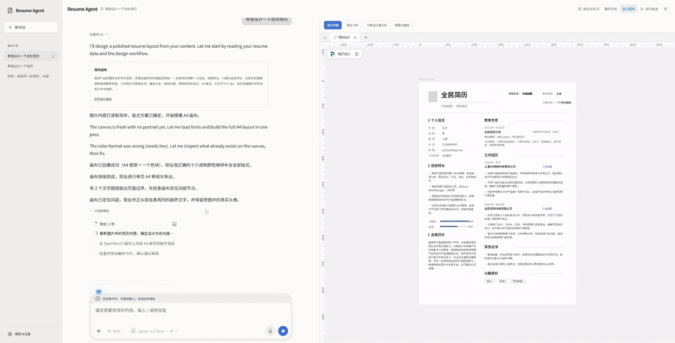
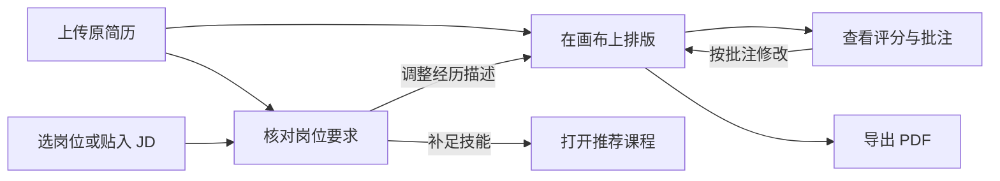
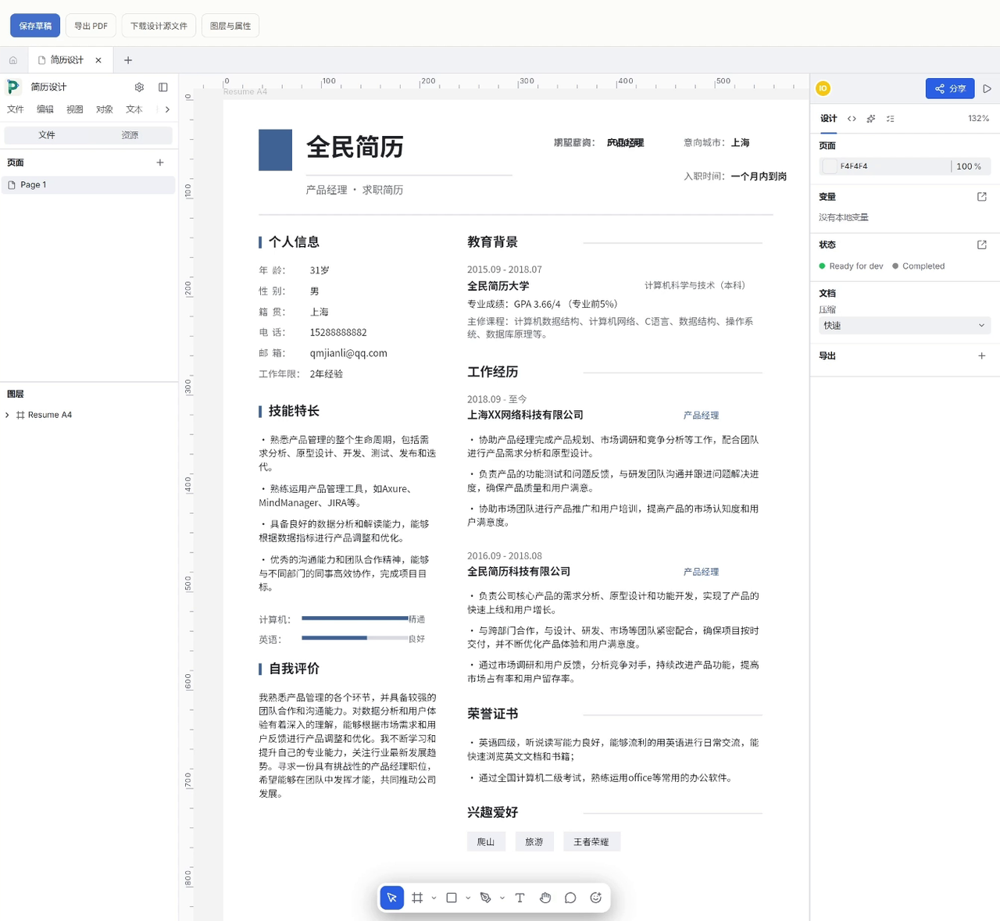
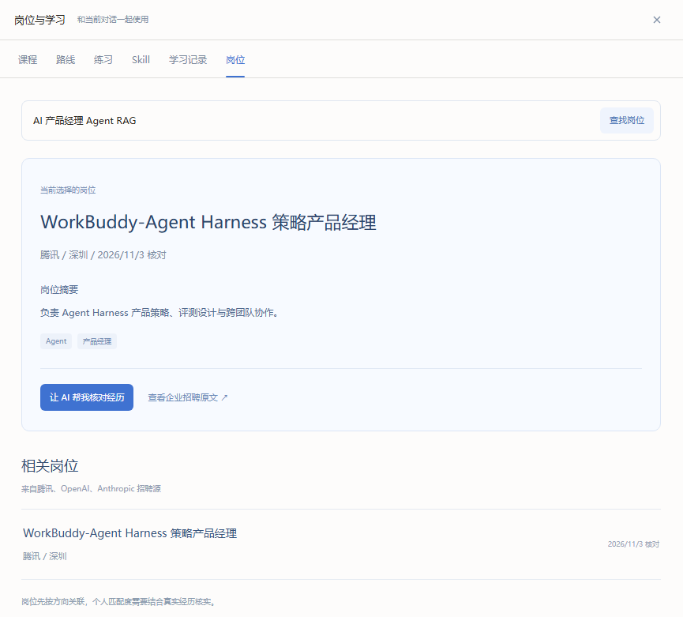
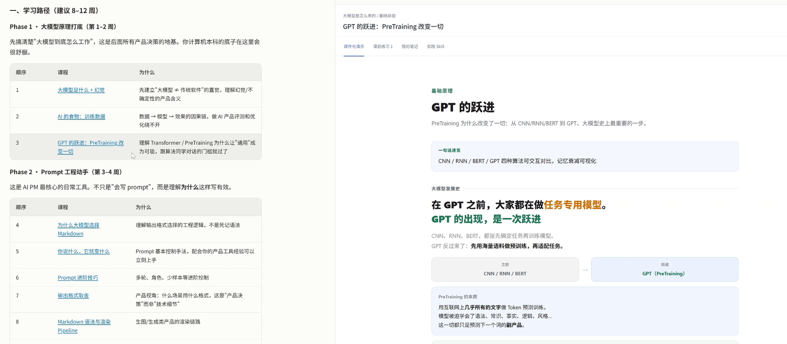
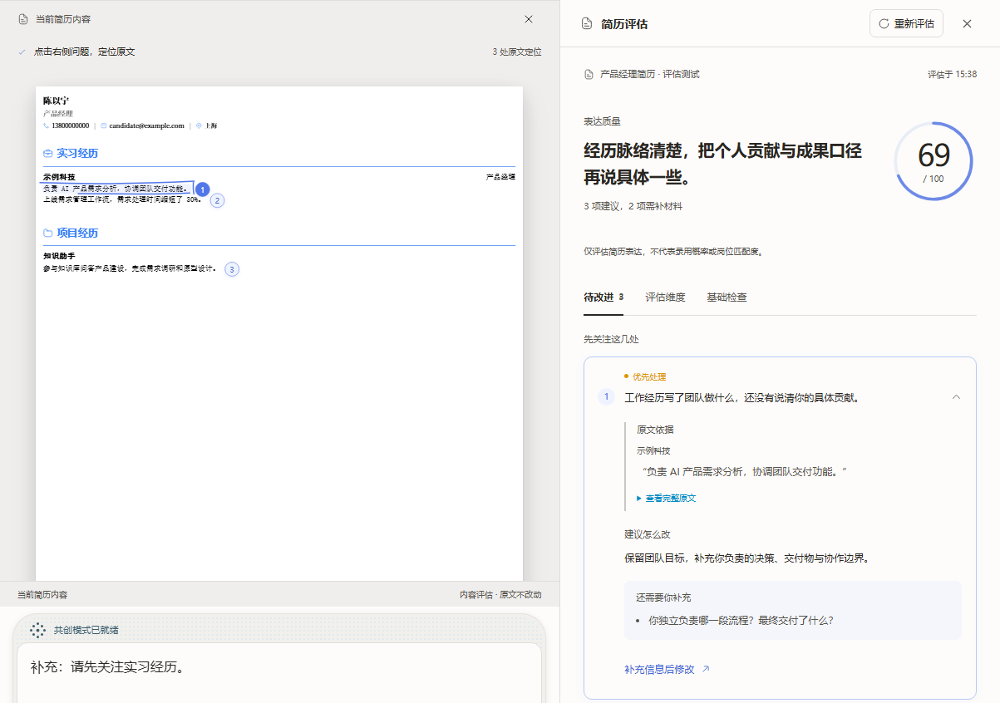

# Resume Agent

上传一份旧简历，在对话里告诉 AI 你想投什么岗位。它会在右侧画布上排出一版可编辑的 A4 简历。你可以直接动手改，也可以圈出一句话，让 AI 按你的意见重写。

在这里播放完整演示（2 分 07 秒）

https://github.com/user-attachments/assets/21f21f02-0eb0-4a6b-a682-f6fe0b2448a7

[下载 MP4](https://github.com/yongze233-ctrl/resume-agent/releases/download/demo/resume-agent-demo.mp4)

## 从原简历到投递稿

## 简历设计

“把两段实习放在主栏，把联系方式和教育放在侧栏，尽量排成一页。” AI 会在 OpenPencil 里调整栏目、字距与留白。画布上的文字可以双击修改，图层可以拖动；定稿后可以导出 PDF，也可以保留可编辑的设计源文件。

## 岗位 JD 匹配

想找 AI 产品经理，可以直接在对话里搜索，也可以贴入已有 JD。目前支持检索腾讯、OpenAI 和 Anthropic 的公开岗位。点开一个结果，右侧能看岗位要求和企业招聘原文。选择 **让 AI 帮我核对经历**，再让它按这份 JD 起草修改，确认后采用。

## 课程学习

“这个岗位要求理解大模型，我有两周，每天能学半小时。” AI 可以从内置的 **454 节课**里选出相关内容，安排学习顺序。点对话中的课名，课件就在右侧打开，可以接着做练习、记笔记。图中点开的是《GPT 的跃进》。

## 简历评估

选择要评的那版简历，查看分数，再点批注回到原句。图里的“负责 AI 产品需求分析，协调团队交付功能”交代了团队做什么，却很难看出候选人负责哪项决策。你可以在对话里补充具体交付物，让 AI 据此改写这段经历。

## 本地启动

准备 Git、Node.js 22.13 或更高版本、pnpm 10.28.1 和 **Bun 1.4.2**。完整工作台运行三个本地服务。请在各个终端使用同一份检出目录。

**第一次安装**

~~~sh
git clone https://github.com/yongze233-ctrl/resume-agent.git
cd resume-agent
pnpm install --frozen-lockfile
pnpm --filter @magic-resume/genui build
pnpm --filter @magic-resume/agent exec playwright install chromium
node scripts/setup-canvas.mjs
cd OpenPencil
bun install --frozen-lockfile
bun run build:packages
~~~

安装脚本按固定提交下载 OpenPencil，并应用本仓库的画布集成。Linux 如果缺少 Chromium 系统依赖，可使用 Playwright 的 `install --with-deps chromium`。

在仓库根目录下创建 **`apps/web/.env.local`**，写入这一行，将前端连到本地 Agent。

~~~dotenv
AI_BACKEND_URL=http://127.0.0.1:4000
~~~

**分别启动三个服务**（每行在新的终端中执行，从仓库根目录开始）

| 服务 | 命令 | 地址 |
| --- | --- | --- |
| AI Agent | `pnpm --filter @magic-resume/agent dev:stable` | http://127.0.0.1:4000/health |
| 设计画布 | `cd OpenPencil`，再执行 `bun run dev --host 127.0.0.1 --port 1420` | http://127.0.0.1:1420 |
| 工作台 | `pnpm --filter @magic-resume/web dev --hostname 127.0.0.1 --port 3000` | http://127.0.0.1:3000/dashboard |

打开工作台，在 **模型与设置** 填入你自己的模型服务地址、模型名和 API Key。画布设计需要支持工具调用的模型。从图片简历开始时，请选择支持图片输入的模型。第一次试用可以上传仓库中的[示例简历 PDF](apps/agent/test/fixtures/resume.pdf)，先发一句“根据这份简历设计一页 A4”，再试试搜索岗位和打开课程。

**给测试用户部署。** 管理员可在 Web 服务端配置 `DEFAULT_MODEL_BASE_URL`、`DEFAULT_MODEL_NAME` 和 `DEFAULT_MODEL_API_KEY`。生产模式默认从同源的 `/pencil` 加载画布。仓库根目录的 Compose 文件启动 Web 和 Agent，画布需要另行构建和提供服务。简历和对话保存在浏览器中；使用 AI 时，任务所需的材料会发送到配置的 Agent 和模型服务。[Web 配置样例](apps/web/.env.example) · [Agent 配置样例](apps/agent/.env.example)

**共享模型切换。** 在 Web 服务端设置 `SITE_OPENCODE_GO_API_KEY` 和 `SITE_AGNES_API_KEY`，即可同时提供 DeepSeek V4.1 Flash 和 Agnes 3.0 Flash。用户点击聊天输入框下方的模型名称即可切换，选择会保存在当前浏览器中，也可以继续使用自己的 API Key。`DEFAULT_MODEL_*` 仍决定初始默认模型；未配置默认时，优先使用已配置的 DeepSeek，其次是 Agnes。共享 Key 只保留在服务端，不会下发给浏览器。

## 源码导航

| 目录 | 可以从这里看什么 |
| --- | --- |
| [apps/web](apps/web) | Next.js 对话工作台、附件上传、画布侧栏、学习页和评估报告 |
| [apps/agent](apps/agent) | Agent 运行循环、简历解析、画布工具、任务恢复与岗位检索 |
| [canvas/overlay](canvas/overlay) | 叠加在固定版 OpenPencil 上的原生画布修改与通信接口 |
| [apps/agent/skills](apps/agent/skills) | 设计、排版、简历评估和岗位匹配的工具使用规则 |
| [scripts/import-xueai.mjs](scripts/import-xueai.mjs) | 小山学堂课程、习题与配套资源的导入入口 |
| [docs/testing](docs/testing/README.md) | 浏览器回归脚本运行说明、画布实测与故障排查报告 |

## 开源与致谢

工作台基于 [Magic Resume](https://github.com/Magic-Resume/Magic-Resume)，可编辑画布基于 [OpenPencil](https://github.com/open-pencil/open-pencil)。感谢两个项目，以及提供课程、字体和排版参考的作者。

应用代码沿用 [MIT 许可](LICENSE)。课程资料采用 AGPL-3.0，Vibe Resume 原始模板和技能资料采用 CC BY-NC 4.0，字体另有各自的许可。分发或商用时，请按具体目录核对条款。[第三方署名与许可清单](THIRD_PARTY_NOTICES.md)
