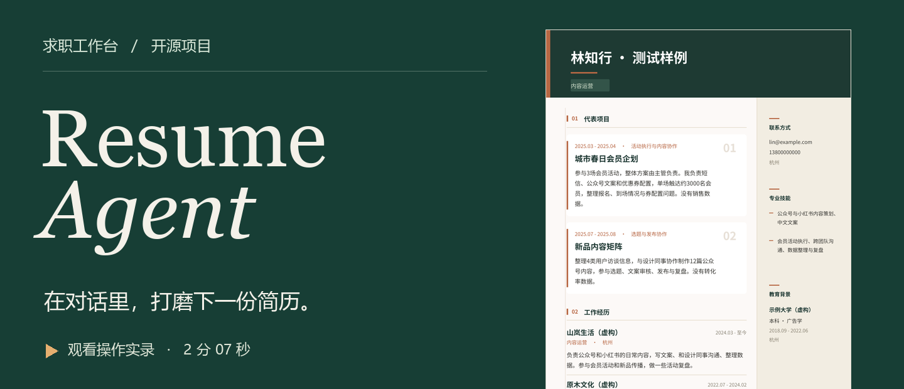
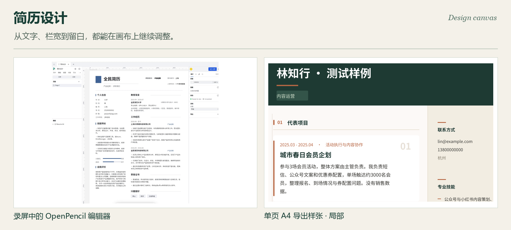
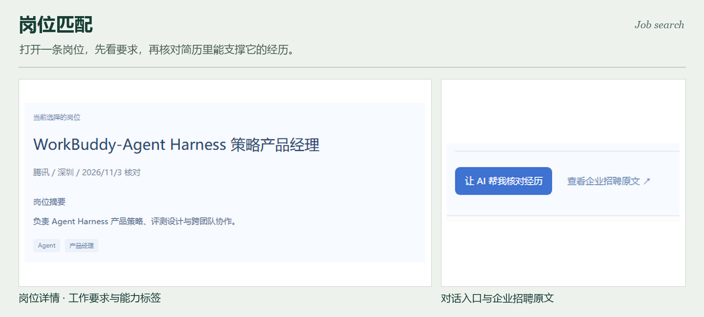
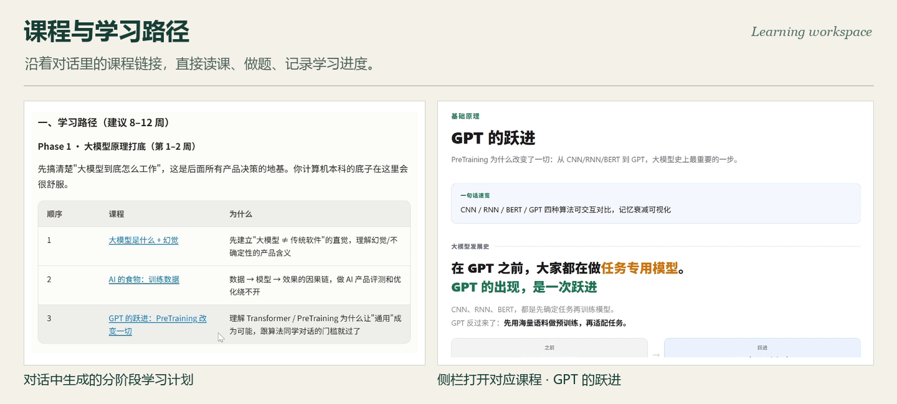
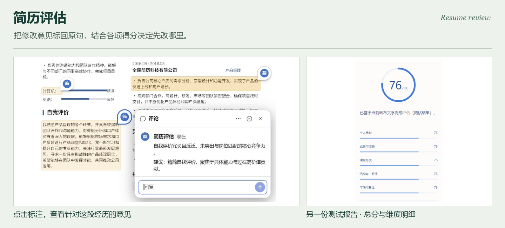

# Resume Agent

一款可以自己部署的中文 AI 求职工作台。上传现有简历，在左边告诉 AI 想投什么岗位，右边就能打开可编辑的设计稿、招聘原文、课程或评估批注。一份简历可以在同一个对话里反复打磨。

**[观看或下载完整演示（MP4，约 6 MB）](https://github.com/yongze233-ctrl/resume-agent/releases/download/demo/resume-agent-demo.mp4)** · [仓库内的视频文件](docs/media/resume-agent-demo.mp4) · [本地启动](#本地启动) · [第三方内容及许可](THIRD_PARTY_NOTICES.md)

录屏使用示例简历。可以从 **00:20** 看设计画布，**01:29** 看原文批注，**01:45** 看学习路径与内置课程。

## 简历设计

> “把这份简历排成一页 A4。项目经历放主栏，教育和联系方式放侧栏，保留原来的照片。”

AI 能在 OpenPencil 上建立画板、排列文字图层、调整字号、行距和留白。你可以双击一行改字，拖动一个栏目，或者直接在需要调整的位置留评论，让 AI 接着改。目标是把简历排成清晰可读的一页；可以保存草稿、导出 PDF，也可以下载可继续编辑的设计源文件。

## 岗位 JD 检索与定向改稿

> “找几个适合我经历的 AI 产品岗位，给我原招聘链接，再按我选的那个岗位改简历。”

在聊天中点开岗位链接，右侧会显示工作地点、要求、核对日期和企业招聘原文。当前接入腾讯招聘，以及 OpenAI 和 Anthropic 的公开职位源。你也可以直接贴入目标 JD。

选中岗位后，点 **让 AI 帮我核对经历**，逐项对照要求与简历里的证据。接着可以让 AI 拟一版针对该岗位的改稿，确认后再采用。职位是否仍在招，以企业招聘原文为准。

## 课程学习与个人路径

> “这个 JD 要求理解大模型评测。我只有两周，每天半小时，先学哪几课？”

AI 能把岗位要求与已有经历对照，按你的时间选课、排顺序，给出可以直接打开的课程链接。点击其中一节，右侧就能看课件、做练习、写笔记；左侧保留原来的对话，可以接着问这节课怎么用到自己的项目里。

仓库随附的小山学堂内容快照有 **454 节课、22 个能力方向、350 道练习题**。课件来源、导入版本与改动均有记录。[查看课程清单](apps/agent/resources/learning-catalog.json) · [课程署名](apps/web/public/learning/xueai/NOTICE.txt)

## 简历评估与原文批注

> “只评估右边这版简历。圈出最难判断我个人贡献的地方，我补充事实后再帮我改。”

选择要评估的那份简历，可查看总分、分项表现，以及具体到原句的改进意见。点击画布上的批注，就能看见哪一句缺少依据、哪段经历没交代贡献。你可以在对话里补充真实情况，让 AI 据此修改，再评估新版本。

## 本地启动

准备 Git、Node.js 22.13 或更高版本、pnpm 10.28.1 和 **Bun 1.4.2**。完整工作台运行三个本地服务。请在各个终端使用同一份检出目录。

**第一次安装**

~~~sh
git clone https://github.com/yongze233-ctrl/resume-agent.git
cd resume-agent
pnpm install --frozen-lockfile
pnpm --filter @magic-resume/genui build
pnpm --filter @magic-resume/agent exec playwright install chromium
node scripts/setup-canvas.mjs
cd OpenPencil
bun install --frozen-lockfile
bun run build:packages
~~~

安装脚本按固定提交下载 OpenPencil，并应用本仓库的画布集成。Linux 如果缺少 Chromium 系统依赖，可使用 Playwright 的 `install --with-deps chromium`。

在仓库根目录下创建 **`apps/web/.env.local`**，写入这一行，将前端连到本地 Agent。

~~~dotenv
AI_BACKEND_URL=http://127.0.0.1:4000
~~~

**分别启动三个服务**（每行在新的终端中执行，从仓库根目录开始）

| 服务 | 命令 | 地址 |
| --- | --- | --- |
| AI Agent | `pnpm --filter @magic-resume/agent dev:stable` | http://127.0.0.1:4000/health |
| 设计画布 | `cd OpenPencil`，再执行 `bun run dev --host 127.0.0.1 --port 1420` | http://127.0.0.1:1420 |
| 工作台 | `pnpm --filter @magic-resume/web dev --hostname 127.0.0.1 --port 3000` | http://127.0.0.1:3000/dashboard |

打开工作台，在 **模型与设置** 填入你自己的模型服务地址、模型名和 API Key。画布设计需要支持工具调用的模型。从图片简历开始时，请选择支持图片输入的模型。第一次试用可以上传仓库中的[示例简历 PDF](apps/agent/test/fixtures/resume.pdf)，先发一句“根据这份简历设计一页 A4”，再试试搜索岗位和打开课程。

**给测试用户部署。** 管理员可在 Web 服务端配置 `DEFAULT_MODEL_BASE_URL`、`DEFAULT_MODEL_NAME` 和 `DEFAULT_MODEL_API_KEY`。生产模式默认从同源的 `/pencil` 加载画布。仓库根目录的 Compose 文件启动 Web 和 Agent，画布需要另行构建和提供服务。简历和对话保存在浏览器中；使用 AI 时，任务所需的材料会发送到配置的 Agent 和模型服务。[Web 配置样例](apps/web/.env.example) · [Agent 配置样例](apps/agent/.env.example)

## 源码导航

| 目录 | 可以从这里看什么 |
| --- | --- |
| [apps/web](apps/web) | Next.js 对话工作台、附件上传、画布侧栏、学习页和评估报告 |
| [apps/agent](apps/agent) | Agent 运行循环、简历解析、画布工具、任务恢复与岗位检索 |
| [canvas/overlay](canvas/overlay) | 叠加在固定版 OpenPencil 上的原生画布修改与通信接口 |
| [apps/agent/skills](apps/agent/skills) | 设计、排版、简历评估和岗位匹配的工具使用规则 |
| [scripts/import-xueai.mjs](scripts/import-xueai.mjs) | 小山学堂课程、习题与配套资源的导入入口 |

## 开源与致谢

工作台基于 [Magic Resume](https://github.com/Magic-Resume/Magic-Resume)，可编辑画布基于 [OpenPencil](https://github.com/open-pencil/open-pencil)。感谢两个项目，以及提供课程、字体和排版参考的作者。

应用代码沿用 [MIT 许可](LICENSE)。课程资料采用 AGPL-3.0，Vibe Resume 原始模板和技能资料采用 CC BY-NC 4.0，字体另有各自的许可。分发或商用时，请按具体目录核对条款。[第三方署名与许可清单](THIRD_PARTY_NOTICES.md)
