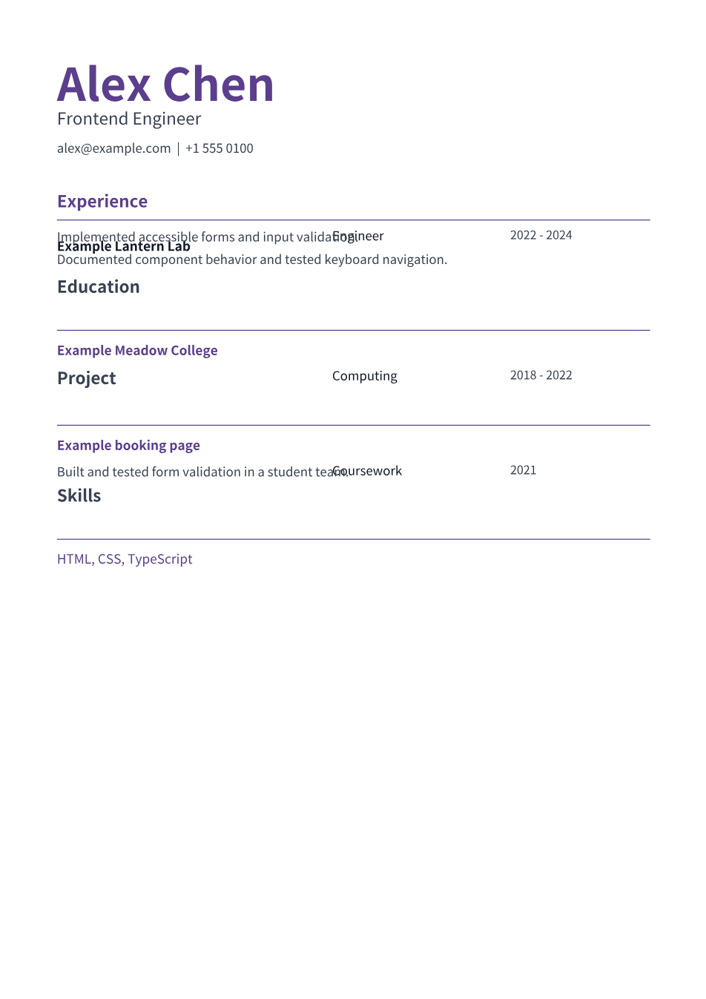
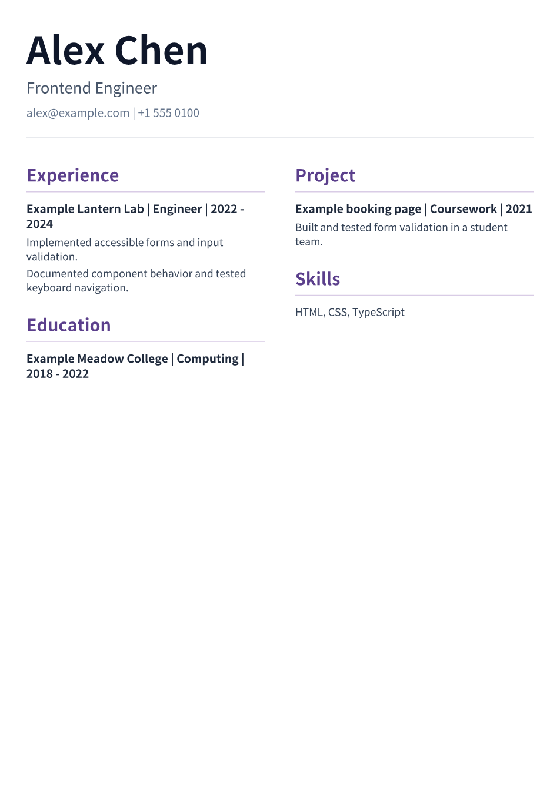
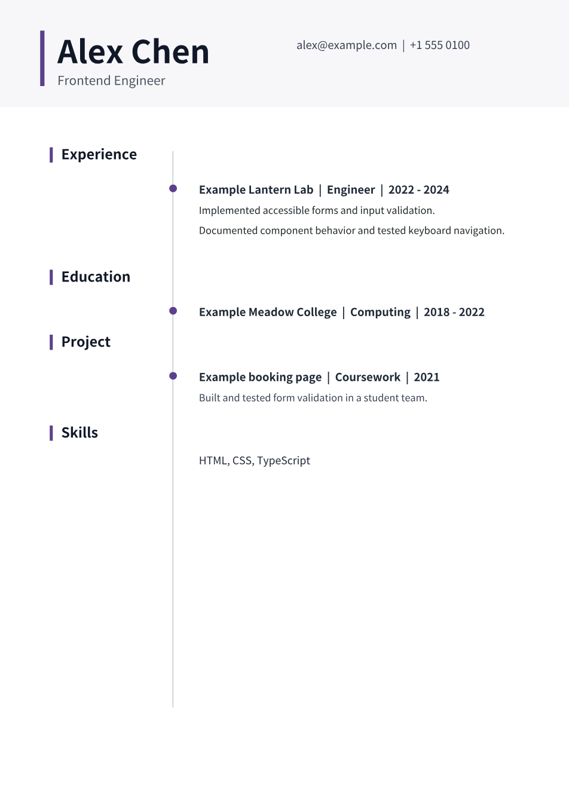
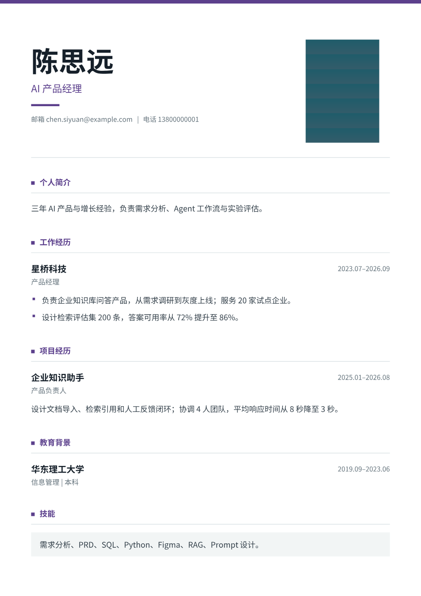

# 设计画布回归实测 · 2026-11-05

本轮覆盖真实画布操作、上传与连续对话、评估批注、停止和排队、PDF / FIG 导出及刷新恢复。发现并修复了三处应用问题，也确认了线上与本地的版本差异。不能把此前所有中断都归因于模型供应商。

文中的截图来自合成简历，包含虚构姓名和测试图片；没有公开真实用户简历、账号、附件标识或模型密钥。

## 已修复的问题

| 问题 | 实际表现与原因 | 修复与验证 |
| --- | --- | --- |
| 工具返回值无法传输，却一直等待 | 模型返回了未调用的 async 函数；`postMessage` 无法克隆函数，宿主没收到回执，最后报画布超时 | 捕获传输失败，立即返回可修复错误；保留请求 ID，重试同一请求不会重复绘制。真实浏览器验证 |
| 连续编辑时重新理解原图，修改范围失控 | 每次工具执行后，原始图片都被追加成最新用户消息；模型可能把“只改颜色”理解成再次导入和重建 | 图片归属原始上传消息，保留工具调用顺序和用户最新指令。真实模型两轮设计、审查、导出验证 |
| 指定画板消失后导出另一份简历 | 明确传入的画板 ID 不存在时，代码仍尝试选择唯一 A4 | 显式 ID 失效直接报错。自动选择仅在未指定 ID 时使用 |

同时完善原生 API 的反馈：宽高应使用 `resize`，编辑前检查节点是否存在，函数需要执行并等待，返回普通数据；小范围修改只调整指定属性。这些提示减少误用，但不能保证模型永不写错代码。

以上三处修复及 API 提示已部署到测试站点。线上采用针对现有版本的局部修复，没有直接用本地全部代码覆盖线上。

## 测试矩阵

| 范围 | 覆盖情况 | 最终结果 |
| --- | --- | --- |
| 原生绘图 | A4、中文 / 英文文字、字体、颜色、线条、矩形、图片、文字测量 | 通过 |
| 图层编辑 | 移动、缩放、克隆、组合、删除、撤销、重做、纵向自动布局 | 通过 |
| 错误边界 | 非有限坐标、不可传输返回值、执行抛错、失效画板 ID、重复请求 | 通过；抛错前的部分修改仍可能留下，见后续计划 |
| 导出与恢复 | 单页 PDF、可提取文字、图片嵌入、可编辑 FIG 往返、刷新恢复 | 通过 |
| 附件 | DOC / DOCX 上传失败与重试、首条消息附件传递、原图提取及恢复 | 本地通过；线上照片提取接口缺失 |
| 原生评论 | 评论、回复、位置锚点进入 Agent 上下文 | 通过；模型回复使用受控测试数据 |
| 多版本评估 | 明确选择简历、独立输入和报告、批注、批量评估、刷新 | 通过；评分使用受控测试数据 |
| 评估取消 | 面板关闭、顶部关闭、再次切换、发现画板期间取消、迟到事件 | 通过；关闭评估不取消无关对话 |
| 连续输出与任务 | 工具切换不丢文字、停止、失败后继续、刷新任务状态 | 通过 |
| 输入排队 | 运行中输入、FIFO、立即处理、停止暂停队列、移除、刷新保留 | 通过；使用受控流验证调度，不调用付费模型 |
| 其他交互 | 侧栏忙碌状态、课程侧栏和未保存画布、语音状态、工具标记过滤 | 通过；语音识别为模拟事件 |

本地最终 **14 组浏览器流程通过**。初次运行是 7 / 12 组通过；其余涉及旧画布构建、测试模型配置及缺失测试附件。修正环境和测试前提后逐项复测，再补充原生工具与排队两组。没有把初次失败从记录中抹掉。

其他检查：后端 **262** 项、前端单元 **163** 项、入口交接 **2** 项、模型设置 **2** 项、画布单元 **4** 项通过；API 边界、栏目导出、后端构建与 lint、画布生产构建通过。前端完整命令初次在 Content-Type 严格相等断言处退出；调整为接受合法的 `charset=utf-8` 后，单独跑完 API 和余下栏目导出检查。

## 真实模型测试

统一任务：上传附件 → 生成一页可编辑简历 → 审查 → 导出 PDF / FIG → 要求只改主色和姓名大小 → 再审查、导出 → 刷新并核对文本。每次使用独立浏览器上下文，不覆盖已有用户简历。

| 模型 / 环境 | 材料 | 首轮 / 修改耗时 | 结果 |
| --- | --- | --- | --- |
| DeepSeek V4.1 Flash / 本地 | 中文 DOCX，含合成照片 | 156.5s / 43.8s | 通过，单页、关键事实和原图保留 |
| Agnes 3.0 Flash / 本地首次 | 英文图片简历 | 约 123s 后失败 | 发现返回函数导致画布请求超时 |
| Agnes / 只修传输后 | 同一图片材料 | 108.3s / 155.0s | 首轮通过，修改后排版重叠，最终审查失败 |
| Agnes / 补齐图片消息修复后 | 同一图片材料 | 57.4s / 39.5s | 通过，修改后审查通过，刷新可恢复 |
| Agnes / 线上真实账号 | 同一图片材料 | 127.8s / 27.2s | 通过，工具调用、连续修改、导出和刷新均验证 |
| DeepSeek V4.1 Flash / 线上真实账号 | 同一图片材料 | 138.9s / 35.3s | 通过，工具调用、连续修改、导出和刷新均验证 |

这些是单次观察，不能当作平均性能或成功率。各轮模型输出不同，不是严格统计实验。线上与本地代码也并非完全一致。

一次重要的测试修正：早期脚本只验证“能下载 PDF”，因此将一份文字重叠的结果标成通过。查看实际审查事件和渲染图片后，已将该轮重新判为失败，并在脚本加入“最后一次修改后的审查必须通过”。能导出文件不等于交付合格。

### 修改失败与修复后

相同合成图片材料，要求只修改主色和姓名大小。左侧问题来自旧图片被重复注入为新消息后发生的额外布局改动；修复后连续编辑保持可读。两张图是不同模型运行的实际 PDF 渲染，不是人工美化的效果图。

| 修复前：修改后重叠，判失败 | 修复后：最终审查通过 |
| --- | --- |
|  |  |

### 线上结果与含照片 Word 结果

| 线上图片简历连续编辑 | 本地 Word 简历保留原图 |
| --- | --- |
|  |  |

## 线上仍存在的版本差异

线上 `POST /api/uploads/attachment/portrait` 返回 404；部署版本没有当前本地的原图提取实现。线上原生画布测试改用直接提供的合成图片，验证了绘图、编辑、错误回执、失效 ID、PDF / FIG 等 8 项，但这**不代表**线上原图自动提取通过。

另外，旧后端的设计提示仍包含多页策略，与本地的默认单页约束不同。当前合成材料确实生成了一页，但不能据此认为线上已经具备本地全部单页和照片处理能力。下一次完整版本发布需要让前端、Agent、画布和技能使用同一发布清单，并跑账号隔离、上传、导出回归。

## 建议下一轮更新顺序

1. **统一发布版本。** 发布清单记录前端、Agent、画布、技能版本；把真实上传、设计、连续修改、导出列为发布门槛，避免“本地已修、线上仍旧”。
2. **让设计修改可恢复。** 保留最后一次通过审查的版本，在草稿副本里执行修改；失败后可恢复。现在一次 JS 操作中途抛错，前面已经完成的图层变动可能仍在，需要检查或撤销。
3. **收敛模型能执行的编辑操作。** 常用文字、颜色、图片、间距、布局改为带参数校验的操作；提前检查节点 ID、数值与作用范围，减少模型一次生成大段 JS 后反复修错。
4. **建立内容完整性检查。** 原始材料形成事实清单；姓名、联系方式、经历、日期、数字、照片与导出稿核对。当前版式审查通过不能证明没有漏内容。
5. **分开处理稳定性与设计质量。** 本轮证明了工具链可用性，不代表审美已达到目标。下一轮用固定模板和明确的字号、留白、密度规则，再比较同一材料下的设计效果。

## 可复跑的新增脚本

在仓库根目录、依赖与本地服务已启动的情况下：

```bash
node --import ./apps/agent/node_modules/tsx/dist/loader.mjs scripts/test-canvas-tools.mjs
node scripts/test-chat-queue.mjs
```

原生画布测试默认使用本地 Web 3000、Canvas 1420，读取仓库内合成 DOCX；支持 `QA_WEB_URL`、`QA_CANVAS_URL`、`QA_OUTPUT_DIR`，需要账号时用环境变量 `QA_LOGIN_USERNAME` / `QA_LOGIN_PASSWORD`。可选 `QA_CANVAS_IMAGE_FILE` 仅用于独立画布测试，启用后会明确标记未测试上传和照片提取。

本轮浏览器以 Chromium 为主；没有覆盖所有操作系统、Safari / Firefox、真实麦克风权限、多用户并发和长时间断网压力。未承诺所有模型输出都正确，也没有用模拟评分替代对评估质量的验证。
